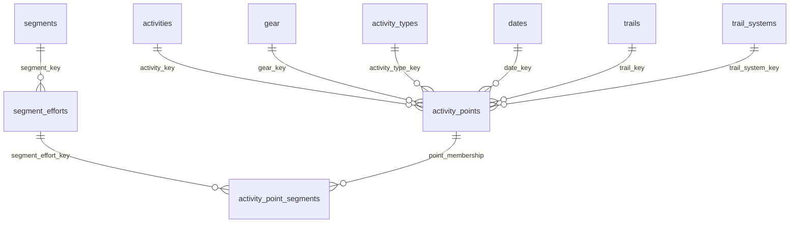

# GPS reporting schema

The reporting fact is one valid GPS sample, unique by `(activity_id, point_index)`.
Source activities, streams, gear, segments and geometry are retained; `activity_points`
is an atomically replaceable derived table. Source IDs are stable dimension keys;
we do not create redundant copies of source entities just to rename them dimensions.
Components and non-GPS reporting are outside this model.



The last relationship is logical, not an active bidirectional Power BI relationship.
The segment-aware mileage measure uses TREATAS to filter distinct point keys,
preventing overlapping segments and repeated efforts from duplicating point mileage.
Segment effort durations remain effort-level measures.

| SQL view | Power BI table | Grain |
|---|---|---|
| view_activity_points | activity_points | GPS sample |
| view_activity | activities | GPS activity |
| view_gear | gear | equipment |
| view_activity_type | activity_types | sport type |
| view_date | dates | point calendar date |
| view_trail | trails | normalized trail |
| view_trail_system | trail_systems | confirmed or candidate system |
| view_segment | segments | Strava segment |
| view_point_segment_effort | segment_efforts | Strava effort |
| view_activity_point_segments | activity_point_segments | point/effort membership |

## Measurement contract

Source storage retains Strava metric units. Reporting exposes miles, feet, mph,
Fahrenheit, seconds, bpm, rpm, watts and percent. Point increments are not rounded.
Activity totals remain Strava totals on `activities`; do not sum them through a
point join. `Whole Activity Miles` sums each selected activity once. Normal miles
sum point increments and can differ from Strava totals due to excluded/invalid
intervals, GPS filtering, or Strava's processing. Do not allocate the difference
silently. The first point has no preceding interval and its increments are NULL.

Increments are calculated against the original preceding stream sample, before
GPS filtering. Missing coordinates, nonpositive elapsed increments, negative
cumulative distance increments, and gaps over 60 seconds produce NULL increments
and a quality flag. Valid zero-distance intervals retain their elapsed time.
Moving seconds use Strava's moving flag at the interval endpoint.

Point timestamps are UTC start time plus stream elapsed seconds. New activity
imports capture Strava's IANA timezone in `point_reporting_metadata`. Historical
activities without it explicitly use UTC (`date_basis=utc_fallback`); reimport or
populate verified IANA metadata before relying on local-day comparisons.
Dates span the minimum through maximum point date. Empty datasets have no dates.

## Spatial contract

Only confirmed polygons assign systems. Boundary points are included (`covers`).
Overlaps choose the lowest system ID and expose `boundary_overlap_lowest_id`.
Unmatched keys are NULL (Power BI blank member), never fabricated matches.
Geometry must be valid WGS84 longitude/latitude; invalid geometry fails the rebuild.

Trail matching uses an activity-local azimuthal equidistant projection, nearest
trail within 40 feet in the assigned system. If two candidates are within 10 feet
of one another in distance, leave the trail unmatched and flag ambiguity. This is
an initial proximity model, not directional map matching; parallel trails require
real-route review. Distance is attributed to the interval's ending point; intervals
crossing boundaries are not split. Tolerances are configurable rebuild parameters.

Segment membership uses inclusive original start/end stream indexes. Only streams
whose time and GPS metadata prove original size and time-series alignment are
linked. Historical arrays lack this evidence and remain unlinked until refreshed.
Efforts and segment attributes remain visible even without point membership.

## Build and cutover

From the repository root:

```bash
.venv/bin/python -m pip install -r requirements.txt
.venv/bin/python -m src.tools.rebuild_point_reporting
.venv/bin/python -m src.tools.export_power_bi
.venv/bin/python -m unittest discover -s tests/unit -v
```

The normal `src.main` pipeline also rebuilds points after stream loading.
`initialize_database` creates the additive tables on existing/fresh databases;
Alembic revision `20261031_gps_points` provides the same additive schema for
already migration-managed databases. Do not stamp an unknown historical database.
The pre-existing baseline migration cannot bootstrap source tables from scratch.

Back up a populated SQLite database with SQLite's backup API before cutover.
No source tables are dropped. `view_activity_all` preserves the old activity scope.
Canonical activity/date/segment/trail-system views now follow the new model, so existing report
relationships and date columns require migration. The original Power BI project
is retained as a reference; use the new model under `power_bi/gps` for cutover.
Set its `ExportFolder` M parameter to the local Parquet directory (trailing slash).
Open `power_bi/gps/activity_tracking.pbip` in Power BI Desktop. The starter report
has a blank canvas; the model and initial measures are ready for new visuals.
Desktop rendering and refresh must be verified on a supported Windows machine.

The new model uses single-direction dimension-to-point relationships. It avoids
competing paths through activity, trail and system dimensions. Filtering segments
requires the explicit segment-aware mileage measure; ordinary mileage intentionally
does not respond to disconnected point-membership filters. Component tracking and
legacy progress measures are not included.

Before retiring the old report, reconcile several known routes, all point-key and
dimension-key cardinalities, boundary crossings, trail ambiguity, repeated segment
efforts and import reruns. Benchmark a full history: current rebuilding is per
activity and tests all system polygons/candidate trails; very large trail catalogs
will need spatial indexing and incremental invalidation. No accuracy or full-history
performance claim is made from synthetic tests alone.

The default export contains the ten GPS-model views. Use `--include-legacy`
to also export the six retained legacy views; legacy maintenance exports require
the existing maintenance-table initializer. Geometry and source data are not
removed by the cutover. Rebuild thresholds are exposed as `--max-gap-seconds`,
`--tolerance-feet`, and `--ambiguity-feet`.

### Prepare a local working database before migration

Close ETL jobs and database connections. In your local Fork checkout, run:

```powershell
.\.venv\Scripts\python.exe -m src.tools.prepare_migration_database
```

This backs up the current database under `database/backups/` and replaces
`database/strava_analytics.db` with a verified SQLite working copy. To use a
populated database stored elsewhere, add `--source "C:\path\existing.db"`.
The previous destination is backed up before replacement, and the source remains
unchanged. Both databases and backups are Git-ignored; pulling the branch brings
the helper, not cloud data. Then run the reporting rebuild and export commands.
