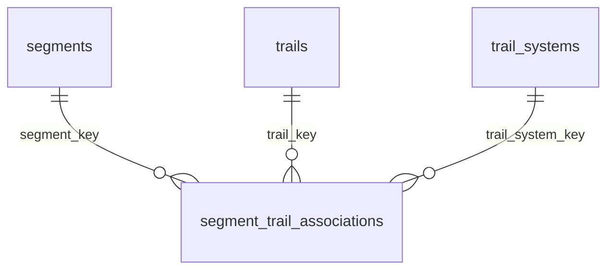

# Observed segment / trail / system associations

`view_segment_trail_association` supplies the `segment_trail_associations` Power BI
bridge. Its grain is one `(segment_key, trail_key, trail_system_key)` combination
observed in verified segment-effort memberships. A system-only row has a NULL
trail key. Points unmatched to both are not association rows.



The existing GPS-point star and segment-effort membership bridge are unchanged.
All three new relationships filter from dimensions to the association bridge in
one direction. There is no relationship to `activity_points`, no dimension-to-
dimension relationship, and no bidirectional filter path.

## Evidence and distance

Only `stream_index_alignment.verified=1` memberships contribute. We reuse GPS
point assignments rather than spatially matching segment endpoints. Rows include:

- Supporting effort count and distinct activity count.
- Point membership count (sample/effort pairs, not unique physical GPS points).
- Observed interval miles, first/last observed UTC timestamps.
- Observed distance share and an evidence status.

The interval ending at the segment's start index is excluded from its distance:
that interval began outside the effort. Subsequent intervals retain the existing
GPS reporting quality exclusions. Repeated efforts add traversal distance and
support counts, not unique geographic coverage. Counts of supporting activities
or efforts must not be summed across associations: one effort may span trails.

`observed_distance_share` divides the row's eligible distance by all eligible
interval distance observed for that segment, including unmatched intervals.
Consequently exported shares may sum to less than 100%. It is a mileage-weighted
historical share, not a confidence score or fraction of the segment's unique
geometry. Zero/unknown denominators remain NULL.

A row with point overlap but no positive eligible distance is `point_only`.
Other rows are `distance_supported`. `association_basis` is always
`verified_point_assignments`: these are inferred observations, not manually
confirmed ownership. Ambiguous trail matches contribute system-only evidence when
the system is known. Confidence scoring and manual overrides are not introduced.

## Apply locally

Close Power BI and pull the branch. From the checkout root:

```powershell
.\.venv\Scripts\python.exe -m src.tools.build_segment_associations
.\.venv\Scripts\python.exe -m src.tools.export_power_bi
```

The first command installs and checks the view without rebuilding any spatial
matches or changing source data. The regular point-reporting pipeline also builds
it through `sql/build_views.sql`. The default exporter now writes **11** files,
with an explicit type contract for the new view, including empty/all-null exports.
The view reflects subsequent verified memberships immediately; re-export to bring
updated association evidence into Power BI. No physical source-table migration,
new secrets, or Strava requests are needed to create this bridge.

## Use in Power BI

After export, open `power_bi/gps/activity_tracking.pbip` and refresh. In a new table
or matrix put `trails[trail_name]` and `trail_systems[trail_system_name]` on rows,
and `Segments Associated` in values. Select a segment or add a segment-name
slicer. Hide rows without associations (visual filter: association count greater
than zero). For positive-distance evidence only, additionally filter
`segment_trail_associations[evidence_status]` to `distance_supported`.

Measures live in `measures_`, in the **Segments / Associations** display folder:

- **Segments Associated**: number of observed combinations.
- **Associated Trails**: distinct nonblank associated trails.
- **Associated Trail Systems**: distinct nonblank associated systems.
- **Observed Segment Association Miles**: additive observed distance per effort.

These catalog measures describe **all verified history**. Date/activity/gear
filters do not reduce them because there is deliberately no route through the
point fact. Use existing `Miles in Selected Segments` for associations represented
by the currently selected activity/date/route. Ordinary `Miles` is intentionally
not segment-aware. Segment names alone will not filter the separate trail dimension;
the association measure suppresses nonexistent trail/system combinations.

Expected local checks: a known Swope segment should show plausible Swope trail
associations, segments spanning multiple trails should retain multiple rows,
unknown trails may appear as blank under a known system, and unverified history
should not create evidence. Neither matching names nor high repeated-mileage
counts establish geographic certainty. Desktop interactions require local validation.

Existing Quanta Check visuals and local layout edits are preserved. Add the
association matrix where appropriate rather than changing ordinary mileage visuals
into history-wide catalog measures.

## GPS-only dataset scope

The exported activity and effort views already require at least one derived valid
GPS point. The activity-type, gear and segment dimension views now also require
use by one of those activities, preventing excluded activities from leaving unused
members in those dimensions. Coordinates determine eligibility, not sport names or
an indoor/trainer flag. One valid GPS point qualifies under the existing rule, even
when there is no usable distance interval.

No report-level filter is required. Original activities, gear and segment records
are retained in source storage. Trail and system geometry catalogs remain available
for mapping and catalog analysis; they do not introduce non-GPS activity records.
Gear lifetime distance remains the source Strava attribute, not a newly calculated
GPS-only usage total; use dataset mileage measures for scoped usage.

`build_segment_associations` refreshes these GPS-scoped dimension views as well as
the association view, so the same two local install/export commands above apply.
A full point/spatial rebuild is unnecessary for this scope change. Refresh Power BI
after all 11 exports succeed. Eligible activity and point totals should stay the
same; activity-type, gear or segment member counts can decrease.

## Diagnose low association coverage before changing tolerances

Run the offline coverage audit on the populated local database:

```powershell
.\.venv\Scripts\python.exe -m src.tools.audit_segment_coverage --explain
```

It prints progress/timings and writes `exports/validation/segment_coverage/`:

- `summary.json`: mutually exclusive coverage categories for GPS-scoped segments.
- `segments.csv`: per-segment effort, verification and point-assignment evidence.
- `verification_candidates.csv`: unverified activities ordered by existing matched
  trail evidence and their count of currently uncovered segments.
- `system_geometry.csv`: boundary confirmation and trail-geometry availability.

Coverage categories distinguish named-trail observations, system-only observations,
verified points outside mapped systems, verified efforts without usable GPS
memberships, and activities awaiting verification. A system-only observation may
reflect an ambiguous match or a missing/too-distant trail; ambiguous membership
counts help distinguish these. No association or tolerance changes are applied.

An activity's candidate-uncovered count is an investigation priority, not a promise
of new matches: unverified indexes are not used to assign trails, activities can
share candidate segments, and matched activity points may belong to a different
part of the ride. Only the existing original-array verification can enable links.
Raw point memberships include effort endpoints, consistent with association counts;
positive eligible distance is a separate evidence status on the association bridge.

Do not treat catalog segment coverage as spatial matching accuracy. Complete
verification where useful, inspect missing geometry, and review ambiguous routes
before widening trail tolerances. Wider tolerances can incorrectly assign parallel
trails. SQL work tables are connection-local TEMP tables and source data is unchanged.

### Verify in coverage-priority order

Use the locally generated candidate CSV to choose higher-value verification reads:

```powershell
.\.venv\Scripts\python.exe -m src.tools.validate_point_reporting --verify-streams --limit 50 --candidate-file exports\validation\segment_coverage\verification_candidates.csv
.\.venv\Scripts\python.exe -m src.tools.audit_segment_coverage
```

The verifier reads the candidate IDs in audit priority order, skips activities
already verified, and puts never-attempted candidates ahead of previously failed
attempts. Unknown IDs and activities without GPS points/segment efforts are skipped.
Re-running the same command resumes eligible candidates; refresh the coverage audit
periodically to update rankings. Without `--candidate-file`, the existing selection
behavior is retained. Verification still requires exact original-array comparison;
this option never relaxes alignment requirements or changes spatial tolerances.

Every selected activity uses a Strava stream read. Respect the reported read
capacity/rate-limit stop messages; the configured limit is a maximum batch size,
not permission to exceed Strava quotas. Candidate counts overlap between rides and
do not guarantee newly associated segments. Geometry missing from a system must
be imported/normalized separately before named-trail assignments can improve there.
